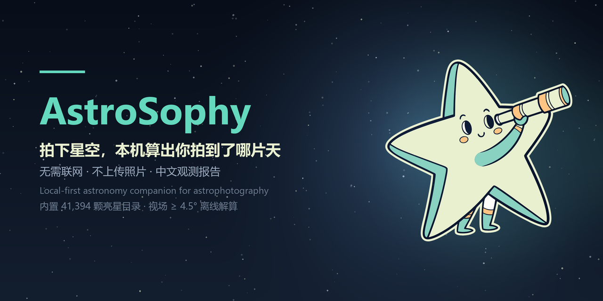

<div align="center">



# AstroSophy

**把手机拍的星空照片交给它，本机算出你拍到了哪片天。**

[中文](./README.md) · [English](./README.en.md)

[](https://github.com/Eddie-Duan/AstroSophy/releases)
[](https://github.com/Eddie-Duan/AstroSophy/releases)


[](https://github.com/Eddie-Duan/AstroSophy/actions/workflows/flutter-ci.yml)
[](./LICENSE)

**Welcome PR. Welcome Issue.**

</div>

面向天文爱好者的 Flutter Android 应用。选一张手机里的星空照片，它在本机找出星点、算出你拍的是哪片天，再把结果整理成看得懂的表格、图和一段说明。**不联网也能用。**

<!-- 截图位：拍好真机截图后放到 docs/screenshots/，取消下面注释即可
<p align="center">
  
  
  
  
</p>
-->

## 它能做什么

| 你给它 | 它在本机做 | 你拿到 |
|---|---|---|
| 一张手机星空原片 | 找星点 → 匹配内置星表 → 算中心坐标与像素比例 | 标注图、观星记录、测量数字 |

- **完全离线**：星表内置（41,394 颗亮星 + 120.6 万颗 Gaia DR3 背景星，约 10 MB），解算不需要网络。
- **窄视场也能解**：1.5°–2.5° 的智能望远镜画面（Seestar、Dwarf 等）同样在手机上解。
- **可读性**：星座、中文星官名、`M 45 昴星团` 这类写法、行星/小行星/彗星，图上四类目标四种记号。
- **可核对**：孔径测光、FWHM、背景噪声、饱和比例全部列出；“看到的”和“算出来的”分开标注。
- **照片出过设备，报告会说**：只有你明确授权时才会调用 Astrometry.net，开关默认关闭。

19 项完整功能（月面分析、飞线判定、全屏导出、Nox 助手等）见 **[docs/FEATURES.md](./docs/FEATURES.md)**。

## 安装

- **APK**：从 [Releases](https://github.com/Eddie-Duan/AstroSophy/releases/latest) 下载 `AstroSophy.apk`
- **源码构建**：见下方「启动」
- 首次安装需允许「安装未知来源应用」

## 启动

安装 Flutter stable SDK、Android Studio 和 Android SDK（JDK 17/21），运行 `flutter doctor` 配好工具链。连接 Android 手机并开启 USB 调试，Windows 双击 [`START.bat`](./START.bat)，或运行：

```bash
flutter pub get
flutter run
```

跑测试：

```bash
flutter test
```

## 文档

- [功能清单](./docs/FEATURES.md) · [English](./docs/FEATURES.en.md)
- [技术与使用说明](./docs/TECHNICAL.md)
- [星表扩展建议](./docs/SUGGESTION.md)
- [AI 路线图](./docs/AI-ROADMAP.md)

## 参与

**欢迎 PR，欢迎 Issue。** 从 [good first issues](./docs/GOOD-FIRST-ISSUES.md) 挑一个开始；提交前请读 [CONTRIBUTING.md](./CONTRIBUTING.md) 和 [CODE_OF_CONDUCT.md](./CODE_OF_CONDUCT.md)。

不会写代码也能帮上忙：按模板提交 Seestar / Dwarf 样片、补翻译、报告设备兼容性。

## 关于这个项目

这是作者的第一个自研项目，也是第一次完整地做一个 App 并长期维护。代码、文档和天文判断里都还有不成熟的地方。看到更稳妥的做法，欢迎直接指出——开 issue、提 PR，或者只说一句「这里可以更好」，都算帮忙。希望借这个项目把东西做好，也和大家一起进步。

## 许可

GNU Affero General Public License v3.0（AGPL-3.0），详见 [LICENSE](./LICENSE)。可以自由使用、修改和分发；如果修改后通过网络向用户提供服务，需要按同一许可证公开对应源码。品牌名称与图标不在此许可范围内。商业合作与双许可的结构见 [docs/LICENSING.md](./docs/LICENSING.md)。

## 致谢

星表数据来自 Hipparcos 与 Gaia DR3（ESA）；深空目录、星名与第三方数据来源见 [docs/TECHNICAL.md](./docs/TECHNICAL.md) 的「数据来源与致谢」。
